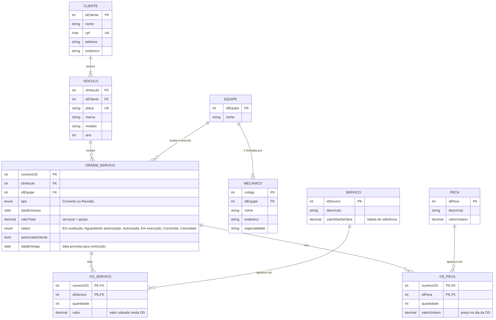
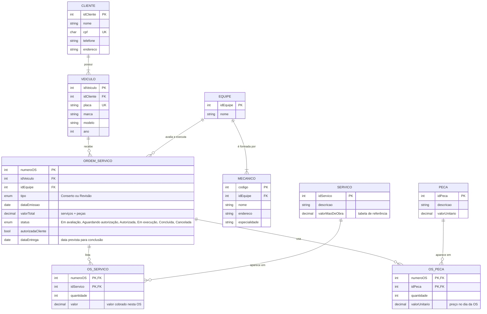

# Projeto Conceitual de Banco de Dados – Oficina Mecânica

Desafio de projeto da DIO: criar do zero o esquema conceitual de um sistema de controle e gerenciamento de ordens de serviço (OS) em uma oficina mecânica.

> O diagrama foi feito em **Mermaid** (arquivo [`oficina.mmd`](oficina.mmd)) e também aparece renderizado no fim deste README.

## Narrativa do desafio
- Sistema de controle e gerenciamento de execução de ordens de serviço em uma oficina mecânica.
- Clientes levam veículos à oficina para conserto ou para revisões periódicas.
- Cada veículo é designado a uma equipe de mecânicos, que identifica os serviços a serem executados e preenche uma OS com data de entrega.
- A partir da OS, calcula-se o valor de cada serviço consultando uma tabela de referência de mão de obra.
- O valor de cada peça também compõe a OS.
- O cliente autoriza a execução dos serviços.
- A mesma equipe avalia e executa os serviços.
- Os mecânicos possuem código, nome, endereço e especialidade.
- Cada OS possui número, data de emissão, valor, status e data para conclusão dos trabalhos.

## Entidades

| Entidade | Descrição |
| --- | --- |
| **CLIENTE** | Dono do veículo. |
| **VEICULO** | Veículo levado à oficina. Pertence a um cliente. |
| **EQUIPE** | Grupo de mecânicos que avalia e executa a OS. |
| **MECANICO** | Código (PK), nome, endereço e especialidade. Faz parte de uma equipe. |
| **ORDEM_SERVICO** | Número (PK), data de emissão, valor total, status e data de entrega. |
| **SERVICO** | Tabela de referência de mão de obra (descrição e valor de cada serviço). |
| **OS_SERVICO** | Serviços incluídos em cada OS (N:M entre OS e SERVICO). |
| **PECA** | Peças com valor unitário. |
| **OS_PECA** | Peças usadas em cada OS (N:M entre OS e PECA). |

## Relacionamentos e chaves

| Relacionamento | Cardinalidade | Como fica |
| --- | --- | --- |
| Cliente possui Veículo | 1:N | `VEICULO.idCliente` (FK) → CLIENTE |
| Veículo recebe OS | 1:N | `ORDEM_SERVICO.idVeiculo` (FK) → VEICULO |
| Equipe é formada por Mecânicos | 1:N | `MECANICO.idEquipe` (FK) → EQUIPE |
| Equipe avalia e executa OS | 1:N | `ORDEM_SERVICO.idEquipe` (FK) → EQUIPE |
| OS lista Serviços | N:M | `OS_SERVICO` com PK composta (numeroOS, idServico), ambas FK |
| OS usa Peças | N:M | `OS_PECA` com PK composta (numeroOS, idPeca), ambas FK |

## Decisões tomadas (o que não estava na narrativa)
- **Um cliente pode ter vários veículos**, mas cada veículo pertence a um único cliente.
- **Cada OS é de um único veículo e de uma única equipe.** A mesma equipe avalia e executa, então basta uma FK `idEquipe` na OS.
- **Cada mecânico pertence a uma equipe.** O código do mecânico é a sua chave primária.
- **Tipo da OS:** `Conserto` ou `Revisão`, já que a narrativa cita os dois motivos.
- **Autorização do cliente:** o atributo `autorizadaCliente` registra se o cliente aprovou. O status acompanha o fluxo: *Em avaliação → Aguardando autorização → Autorizada → Em execução → Concluída* (ou *Cancelada*).
- **Valores da OS:**
  - o valor de cada serviço vem da tabela de referência (`SERVICO.valorMaoDeObra`) e é copiado para `OS_SERVICO.valor`;
  - o preço da peça é guardado em `OS_PECA.valorUnitario`;
  - assim, se a tabela de preços mudar depois, as OS antigas mantêm o valor cobrado na época.
- **valorTotal** = soma dos serviços + soma das peças da OS.
- **Data de entrega:** a "data de entrega" e a "data para conclusão dos trabalhos" da narrativa foram tratadas como o mesmo atributo (`dataEntrega`).

## Diagrama (Mermaid)

## Ferramentas
- [Mermaid](https://mermaid.js.org/) para o diagrama entidade-relacionamento
- GitHub para versionamento e entrega
